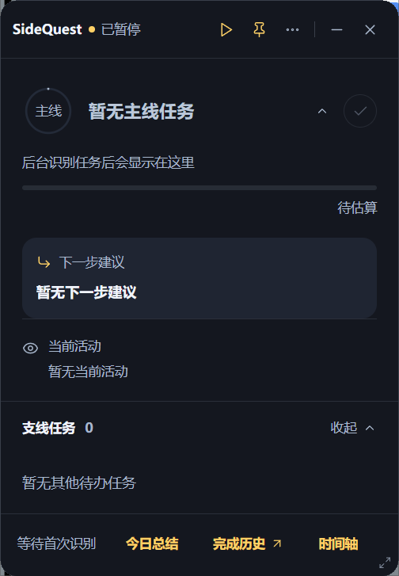
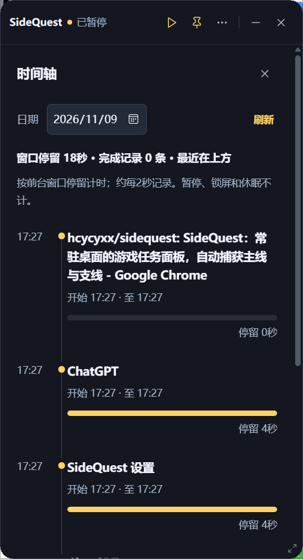
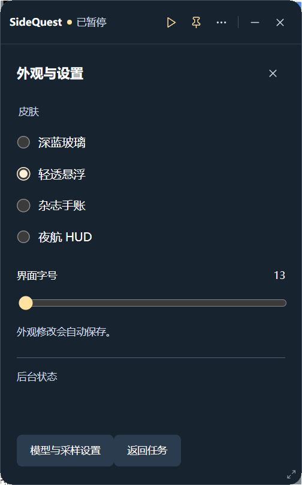
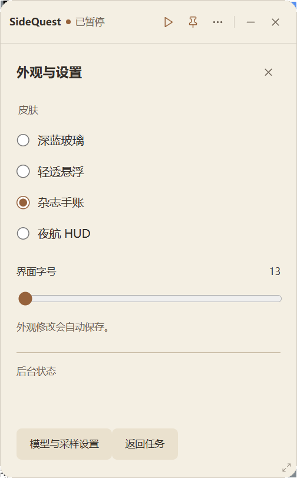
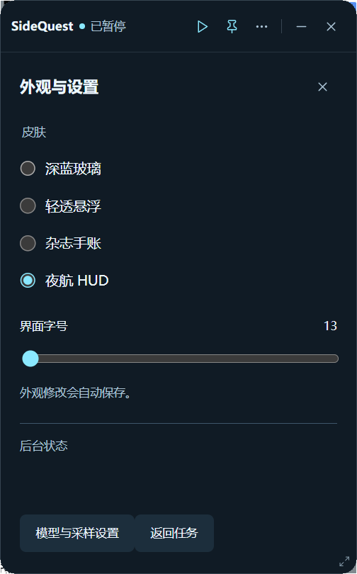

<div align="center">
  <h1>SideQuest</h1>
  <p><strong>把主线、支线与下一步行动，留在桌面上。</strong></p>
  <p>  <a href="https://github.com/hcycyxx/sidequest/stargazers"></a></p>
</div>

Windows 桌面任务面板：结合窗口轨迹与可配置的模型接口辅助整理任务。支持完成确认、任务步骤、时间轴、模型设置和每日总结。

## 效果预览

以下是用户提供的实际界面截图。拍摄时处于暂停状态；主面板暂无任务，不代表任务识别或模型连接已验收。

### 主面板与时间轴

<p>
  <a href="docs/images/main-panel-20261109.png"></a>
  <a href="docs/images/timeline-20261109.png"></a>
</p>

### 主题与外观设置

从左到右：轻透悬浮、杂志手账、夜航 HUD；另支持深蓝玻璃主题。

<p>
  <a href="docs/images/theme-transparent-20261109.png"></a>
  <a href="docs/images/theme-journal-20261109.png"></a>
  <a href="docs/images/theme-night-20261109.png"></a>
</p>

截图为此次详细设置页改版前采集的主面板与外观页，并非 V11.3 模型设置页的新截图。

## 版本与下载

| 内容 | 当前状态 |
| --- | --- |
| 当前源码 | **V11.3**，由 `ui/current_release.json` 指定 |
| 当前安装包 | **V11.3 / v11.3.0**，使用与构建记录一致的完整安装器 |
| 历史安装包 | **V11.2 和 V1.1.0** 保留供回退，不代表当前源码 |
| 实际界面截图 | 已补充上方五张用户截图；V11.3 详细设置页为新设计 |

**[下载 V11.3 完整安装器](https://github.com/hcycyxx/sidequest/releases/download/v11.3.0/SideQuest_V11_3_FullSetup_20261109.exe)** · **[下载源码与中文文档](https://github.com/hcycyxx/sidequest/releases/download/v11.3.0/SideQuest_V11_3_Source_Docs_20261109_v2.zip)** · [版本下载页](https://github.com/hcycyxx/sidequest/releases/tag/v11.3.0)

[历史 V11.2 安装包](https://github.com/hcycyxx/sidequest/releases/tag/v11.2.0) · [历史 V1.1.0 安装包](https://github.com/hcycyxx/sidequest/releases/download/v1.1.0/SideQuest-Setup-1.1.0.exe) · [版本说明](RELEASE_Installer_V11_2_20261107.md) · [更新日志](CHANGELOG.md)

旧 README 提到的 `SideQuest-portable-1.1.0.zip` 目前未见于本仓库已发布附件，不作为可下载文件推荐。V11.1 便携版与 V11.2 安装版的构建说明保留，但不表示它们已发布。

## V11.3 设置页改进

详细设置页与主面板使用同一主题，移除割裂的系统白色标题栏；重新整理标签页、输入框、按钮和滚动条。设置存储、配置导入、模型检测与校验逻辑复用 V11.2。V11.3 已提供独立 Release。用户已确认隔离预览的白条消失、拖动正常；安装包尚未运行验收。

## 功能

- 主线和支线任务、步骤勾选、展开与排序；手动操作优先保留。
- 桌面浮窗、贴边隐藏、托盘及每日总结。
- AI 判断完成后等待用户确认，不以模型判断直接替代用户验收。
- 模型地址、名称和密钥可配置；设置页提供获取模型与连通性按钮。
- V11.2 改善空模型响应、不兼容返回、重试等待及后台状态提示。

## 环境要求

Windows 桌面环境；源码界面使用 Python、pywebview 与 WebView2，设置页使用 tkinter。依赖见 `requirements-ui-v10.txt` 和锁定文件。OCR 及窗口读取按实际需要配置，模型服务需用户自行提供。

V11.3 完整安装包沿用 V11.2 的组件方案，内含 Python、CPU OCR、WebView2 和 .NET 4.8 离线安装程序；缺少微软组件时可能需要管理员确认或重启。构建记录不等于跨电脑运行通过。

## 安装与启动

### 当前源码

仓库保留多代入口，当前使用 `sidequest_latest.py`。不要用旧 `install.ps1` 或旧 `sidequest.py` 的行为推断最新版。

```powershell
python -m venv .venv
.\.venv\Scripts\python.exe -m pip install -r requirements-ui-v10.txt
.\.venv\Scripts\pythonw.exe sidequest_latest.py --panel
```

需要 Python 安装包含 tkinter，并具备可用的 WebView2/.NET 组件。以上直接打开面板，不等于配置完成后台；后台使用基础 Python 环境，窗口抓取和 OCR 依赖需按需在该环境安装。以上为按源码整理的步骤，本轮未完成全新电脑安装验收。`--open` 和 `launch_sidequest_latest.ps1` 另依赖本机预建的 `%LOCALAPPDATA%\SideQuestV10Runtime` 环境，不能直接视为通用安装器。

### V11.3 完整安装版

从 [v11.3.0 Release](https://github.com/hcycyxx/sidequest/releases/tag/v11.3.0) 下载完整安装器；使用与数据策略见 [V11.3 说明](RELEASE_Settings_V11_3_20261109.md) 和 [安装说明](installer_v11_3/使用说明.txt)。安装前关闭旧版，避免两份并行。

## 使用与设置

首次进入设置，填写模型地址、模型名和密钥；确认后由用户启动识别。获取模型与检测连通性只有点击相应按钮才请求接口，不等于模型推理测试。

面板中查看主线与支线，展开步骤、调整任务并确认完成；托盘可显示面板、打开设置和退出。需要暂停时在面板操作，退出前确认后台状态。

源码运行的配置在项目 `config` 目录；V11.2 安装版数据在 `%LOCALAPPDATA%\SideQuestDesktop\data`，安装目录为 `%LOCALAPPDATA%\Programs\SideQuestDesktop`。旧 V1.1.0、便携版与新版安装版的数据路径不同，不能混用。

## 隐私与模型请求

窗口标题、文档片段或 OCR 文字可能进入本地记录，并按配置发送给所选模型接口；是否离开本机取决于接口地址。OCR 在本地处理不代表后续模型请求也是本地。请先确认内容抓取开关与接口服务。

密钥、真实任务、客户记录、窗口历史和每日总结不应提交到 GitHub。关闭抓取、暂停识别等操作以当前界面及配置为准。

## 更新、回退与卸载

更新前退出旧版并备份数据，保存新版到独立目录。使用设置页的导入功能时只选择自己确认过的旧配置。

V11.2 安装版从 Windows 已安装应用中卸载，按版本说明默认保留使用数据；便携版退出后移除对应目录前先备份 `data`。源码版退出面板与后台后保留或备份 `config`、总结，再移除项目目录。旧版本源码与压缩包均保留。

## 构建与验证

当前版本的构建说明见 [V11.3 构建文档](installer_v11_3/构建说明.md)。使用 `installer_v11_3/build_release.ps1` 在新目录编译，当前有效描述文件为 `build_installed_v2.spec` 和 `SideQuestSetup_v4.iss`。构建记录见 [BUILD_RESULT](installer_v11_3/BUILD_RESULT_20261109.json)。

已完成 Python 语法检查、PyInstaller 与 Inno Setup 编译，并核对新设置模块和去白条逻辑已进入程序。用户已确认隔离预览中白条消失、窗口拖动正常。

**安装器执行、打包程序运行、跨机、模型连接和真实任务识别尚未验收。** 最小化/恢复、最大化、缩放、三页保存与四主题切换请先试用。截图中的暂停界面不代表模型识别运行通过。

## 常见问题

- **下载到旧版**：先核对 Release 标签；当前安装版为 v11.3.0，V11.2 和 V1.1.0 是保留的历史版本。
- **后台活着但没有任务更新**：查看最近识别时间、模型错误与本地日志；进程存活不等于推理成功。
- **源码界面无法打开**：检查依赖、WebView2、.NET 和当前入口，不要重复运行多个版本。

<!-- jack-white-rice-support:start -->
## 请大肥鱼吃大白饭 🍚

如果这个项目帮到了你，欢迎请大肥鱼吃一碗大白饭。自愿投喂，量力而行，感谢支持！

<p>
  <a href="assets/support/alipay-jack-v1.jpg"></a>
  <a href="assets/support/rice-meme-v1.png"></a>
</p>
<!-- jack-white-rice-support:end -->

## 文档与许可

[V11.3 改进与使用](RELEASE_Settings_V11_3_20261109.md) · [V11.2 安装说明](RELEASE_Installer_V11_2_20261107.md) · [V11.1 设置改进](RELEASE_Settings_V11_1_20261107.md) · [历史 README 原文](docs/README_legacy_before_20261109.md)

历史 README 记录旧入口与行为，仅供回溯；其中相对路径按原仓库根目录解释。项目尚未声明独立开源许可证；第三方资源仍遵循各自许可，不能以依赖的许可证替代本项目授权。
